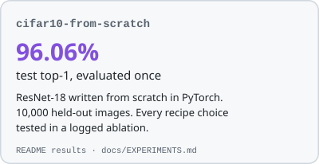
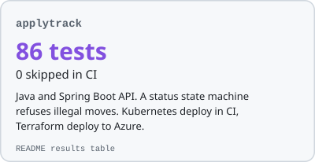
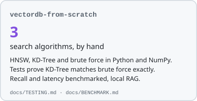
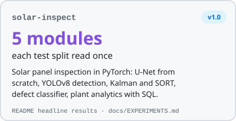
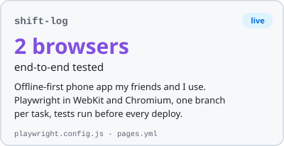
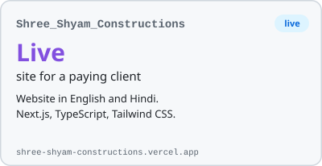
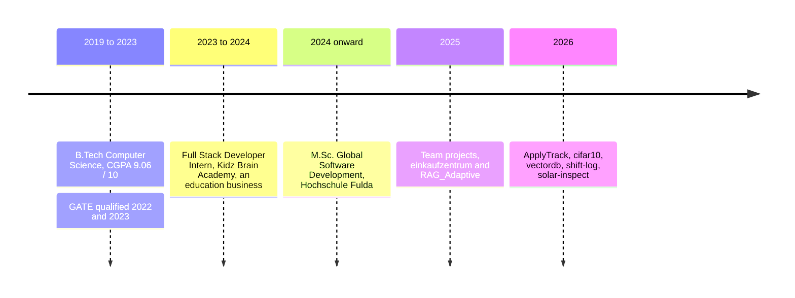

<picture>
  <source media="(prefers-color-scheme: dark)" srcset="assets/header-dark.svg">
  
</picture>

**Open to Werkstudent, internship and part-time roles in Germany:** ML and AI engineering, Java and Python backend, full-stack, QA and test automation, data and automation.

## Projects, one measured result each

  <a href="https://github.com/Uditp11/cifar10-from-scratch"><picture><source media="(prefers-color-scheme: dark)" srcset="assets/card-cifar10-dark.svg"></picture></a>
  <a href="https://github.com/Uditp11/applytrack"><picture><source media="(prefers-color-scheme: dark)" srcset="assets/card-applytrack-dark.svg"></picture></a>
  <a href="https://github.com/Uditp11/vectordb-from-scratch"><picture><source media="(prefers-color-scheme: dark)" srcset="assets/card-vectordb-dark.svg"></picture></a>
  <a href="https://github.com/Uditp11/solar-inspect"><picture><source media="(prefers-color-scheme: dark)" srcset="assets/card-solar-inspect-dark.svg"></picture></a>
  <a href="https://github.com/Uditp11/shift-log"><picture><source media="(prefers-color-scheme: dark)" srcset="assets/card-shift-log-dark.svg"></picture></a>
  <a href="https://github.com/Uditp11/Shree_Shyam_Constructions"><picture><source media="(prefers-color-scheme: dark)" srcset="assets/card-shree-shyam-dark.svg"></picture></a>

Tests run on every push:

| applytrack | cifar10 | vectordb | shift-log | einkaufzentrum |
|:---:|:---:|:---:|:---:|:---:|
|  |  |  |  |  |

## Pick your lane

<b>ML and AI engineering</b>

- [solar-inspect](https://github.com/Uditp11/solar-inspect): five-stage solar panel inspection in PyTorch. U-Net segmentation written from scratch, YOLOv8 detection with IoU, NMS and AP written by hand, Kalman and SORT tracking checked on synthetic flyovers, defect classification with calibration and distillation, and analytics on real plant data. Each of the three image test splits read once. Open the [headline results](https://github.com/Uditp11/solar-inspect#headline-results)
- [cifar10-from-scratch](https://github.com/Uditp11/cifar10-from-scratch): ResNet-18 written from scratch, 96.06% test accuracy. Open the [ablation ledger](https://github.com/Uditp11/cifar10-from-scratch/blob/main/docs/EXPERIMENTS.md)
- [vectordb-from-scratch](https://github.com/Uditp11/vectordb-from-scratch): HNSW and KD-Tree written by hand, local RAG with Ollama. Open the [benchmark](https://github.com/Uditp11/vectordb-from-scratch/blob/main/docs/BENCHMARK.md)
- [RAG_Adaptive](https://github.com/Uditp11/RAG_Adaptive) (team project): LangGraph chatbot that routes each question to documents, the LLM or web search, then grades and retries retrieval

<b>Java and Python backend</b>

- [applytrack](https://github.com/Uditp11/applytrack): Java and Spring Boot API, PostgreSQL with Flyway migrations, a status state machine that refuses illegal moves, statistics computed in SQL
- [vectordb-from-scratch](https://github.com/Uditp11/vectordb-from-scratch): async FastAPI layer over a hand-written vector index
- [einkaufzentrum](https://github.com/Uditp11/einkaufzentrum) (team course project): Flask and SQLAlchemy API with JWT roles and integration tests in CI

<b>Full-stack</b>

- [Shree_Shyam_Constructions](https://github.com/Uditp11/Shree_Shyam_Constructions): live website for a paying client, in English and Hindi. [Open the site](https://shree-shyam-constructions.vercel.app/)
- [shift-log](https://github.com/Uditp11/shift-log): offline-first phone app (service worker, IndexedDB), English and German. [Open the app](https://uditp11.github.io/shift-log/)
- [einkaufzentrum](https://github.com/Uditp11/einkaufzentrum) (team course project): React frontend on a Flask API

<b>QA and test automation</b>

- [shift-log](https://github.com/Uditp11/shift-log): Playwright end-to-end tests in WebKit at iPhone size and Chromium at Android size, run before every deploy. Open [playwright.config.js](https://github.com/Uditp11/shift-log/blob/main/playwright.config.js)
- [applytrack](https://github.com/Uditp11/applytrack): JUnit 5, Mockito and Testcontainers against a real PostgreSQL
- [cifar10-from-scratch](https://github.com/Uditp11/cifar10-from-scratch): pytest on a Python 3.10 and 3.12 CI matrix
- [solar-inspect](https://github.com/Uditp11/solar-inspect): 232 pytest tests, checked against hand-computed values and against torchvision and statsmodels
- [einkaufzentrum](https://github.com/Uditp11/einkaufzentrum) (team course project): three integration suites, run in CI

<b>Data and automation</b>

- [applytrack](https://github.com/Uditp11/applytrack): response rate and status counts computed in SQL
- [solar-inspect](https://github.com/Uditp11/solar-inspect): regression on real solar plant data with Newey-West errors, and five SQLite queries with window functions, each checked against pandas. Open [sql/](https://github.com/Uditp11/solar-inspect/tree/main/sql)
- [einkaufzentrum](https://github.com/Uditp11/einkaufzentrum) (team course project): SQL layer through SQLAlchemy, SQLite and MySQL
- Automation (n8n, Power Automate, Python and JavaScript scripts) was used at work
- Private, not public: my own job-hunt agents, built with Claude, collect postings every day, score them and file them in Notion. I also wrote Claude Code skills and my own MCP server

<picture>
  <source media="(prefers-color-scheme: dark)" srcset="assets/divider-dark.svg">
  
</picture>

## Stack

Every badge below is used in a public repo on this profile.

**ML and AI** &nbsp;

**Backend and data** &nbsp;

**Frontend** &nbsp;

**Testing** &nbsp;

**Cloud and delivery** &nbsp;

## How I work

| Habit | Where to see it |
|---|---|
| Measure before I claim | [cifar10 ablation ledger](https://github.com/Uditp11/cifar10-from-scratch/blob/main/docs/EXPERIMENTS.md): every recipe choice tested against a measured noise floor |
| Touch the test set once | [solar-inspect eval script](https://github.com/Uditp11/solar-inspect/blob/main/scripts/eval_test_d1.py) refuses to run until the config is committed |
| Write decisions down | Decision records in [cifar10](https://github.com/Uditp11/cifar10-from-scratch/blob/main/docs/ADR.md) (retractions kept) and [solar-inspect](https://github.com/Uditp11/solar-inspect/tree/main/docs/adr) |
| One branch per task, tests before deploy | [shift-log workflow](https://github.com/Uditp11/shift-log/blob/main/.github/workflows/pages.yml): deploy waits for the tests |

## Where my skills come from

| Area | Built in public (open the repos above) | Used at work (Kidz Brain Academy, 2023 to 2024) | Coursework (graded, M.Sc. and B.Tech) |
|---|---|---|---|
| ML and AI | PyTorch, NumPy, computer vision (segmentation, detection with YOLOv8, tracking with Kalman and SORT, classification), knowledge distillation, statistics (regression, Newey-West errors, bootstrap intervals), model evaluation (ablations, calibration, leakage checks), vector search, LangGraph, LangChain, OpenAI API, Ollama | OpenAI API in internal tools, with output checks | Classical ML and statistics with scikit-learn, PySpark, Hugging Face |
| Backend and data | Java, Spring Boot, PostgreSQL with Flyway migrations, SQLite with window functions, pandas, FastAPI, Flask, SQLAlchemy, REST APIs, JWT | Node.js and Python services, REST APIs, SQL, data cleaning | Thymeleaf, NestJS |
| Frontend | React, Next.js, TypeScript, Tailwind CSS, offline web apps (service worker, IndexedDB) | React | Vue 3, Angular |
| Testing | pytest, JUnit 5, Mockito, Testcontainers, Playwright | Test cases, manual testing, Postman | Two graded testing courses |
| Cloud and delivery | Docker, Docker Compose, Kubernetes (kind), Terraform on Azure, GitHub Actions, Prometheus and Grafana | | Jenkins |
| Automation | Nothing public yet | n8n, Power Automate, Python and JavaScript scripts | |

<picture>
  <source media="(prefers-color-scheme: dark)" srcset="assets/divider-dark.svg">
  
</picture>

## Background

- M.Sc. Global Software Development, Hochschule Fulda (ongoing)
- B.Tech Computer Science, CGPA 9.06 / 10 · GATE qualified 2022 and 2023
- Full Stack Developer Intern at Kidz Brain Academy, an education business (Feb 2023 to Aug 2024)
- English fluent, Hindi native, German A2/B1 (actively improving, uncertified)

Show as a timeline

## Contact

[Email](mailto:pariharudit03@gmail.com) · [LinkedIn](https://www.linkedin.com/in/uditparihar11/)

<picture>
  <source media="(prefers-color-scheme: dark)" srcset="https://uditp11.github.io/Uditp11/snake-dark.svg">
  
</picture>

<picture>
  <source media="(prefers-color-scheme: dark)" srcset="assets/footer-dark.svg">
  
</picture>

Outside code: football and astrophysics.

